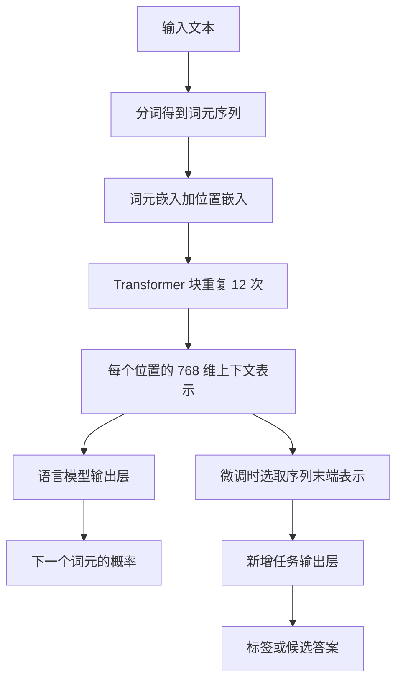
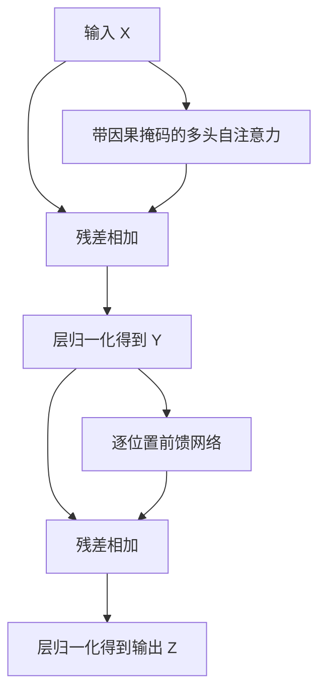

---
aliases:
  - GPT1的模型结构
tags:
  - 知识点
  - GPT
  - 模型架构
---

# GPT1模型架构

## 整体结构

GPT1 使用 12 层仅解码器 Transformer。输入词元嵌入与可学习的位置嵌入相加后，依次经过 12 个 Transformer 块，得到每个位置的上下文表示。预训练时预测下一个词元，任务微调时增加任务输出层。

## 主要规格

| 项目                | 规格             | 含义                |
| ----------------- | -------------- | ----------------- |
| Transformer 块数    | 12             | 顺序堆叠的网络深度         |
| 隐藏状态维度            | 768            | 每个位置的表示宽度         |
| 注意力头数             | 12             | 每层多头注意力的头数，不是网络层数 |
| 每个头的维度            | 64             | 由 $768/12$ 得到     |
| 前馈内部维度            | 3,072          | 前馈网络先扩展再投影回 768 维 |
| 训练序列长度            | 512 个词元        | 论文预训练时采样的连续序列长度   |
| 位置嵌入              | 可学习            | 与词元嵌入相加，提供位置信息    |
| 前馈激活函数            | GELU           | 两次线性变换之间的非线性函数    |
| 分词                | BPE，40,000 次合并 | 合并次数不能直接等同于最终词表大小 |
| 残差、嵌入与注意力 dropout | 0.1            | 训练时的正则化设置         |

## 输入如何进入网络

设输入序列长度为 $T$，词表大小为 $V$。词元嵌入矩阵 $W_e$ 的形状为 $V\times768$。查表取得各词元的向量，再加上相应位置的可学习向量：

$$
H_0=\operatorname{TokenEmbedding}(u_{1:T})+\operatorname{PositionEmbedding}(1:T).
$$

$H_0$ 的形状为 $T\times768$，此处省略批次维度。词元嵌入告诉模型输入是什么，位置嵌入提供输入位于何处的信息。二者是相加，不是拼接成 1,536 维。

## 一个 Transformer 块内部

原论文图 1 中，一个块的顺序如下，残差相加和层归一化位于各子层之后：

忽略 dropout，可以概括为：

$$
Y=\operatorname{LayerNorm}\bigl(X+\operatorname{MaskedMHA}(X)\bigr),
$$

$$
Z=\operatorname{LayerNorm}\bigl(Y+\operatorname{FFN}(Y)\bigr).
$$

这些公式是依据图 1 整理的结构表达，不是原文单独编号的公式。块内输入、输出形状均为 $T\times768$，便于连续堆叠 12 层。

### 带因果掩码的多头自注意力

自注意力让一个位置根据其他允许访问的位置更新自己的表示。因果掩码使位置 $t$ 只能访问自身和更早的输入位置，禁止访问未来位置。在用位置 $t$ 的表示预测位置 $t+1$ 的词元时，它不能看到那个目标词元。

例如，对“我们去公园”这段上下文进行计算时，“去”所在位置不能读取后面的“公园”。这是避免答案泄漏的结构约束。

每层有 12 个头，每个头使用不同的学习投影计算注意力，最后将结果组合回 768 维。不同头可能学到不同关系，但不能预先认定某个头固定负责语法或事实。

### 逐位置前馈网络

每个位置分别通过相同的网络：

$$
\operatorname{FFN}(x)=\operatorname{GELU}(xW_1+b_1)W_2+b_2.
$$

维度变化为 $768\rightarrow3072\rightarrow768$。其中 [[GELU激活函数|GELU]] 逐元素提供平滑的非线性变换。前馈网络本身不跨位置混合信息；跨位置的信息交互主要通过注意力完成。不同位置共享同一层的前馈参数。

### 残差与层归一化

残差连接将子层的输入与其计算结果相加，有助于信息和梯度跨层传递。层归一化对每个位置的表示进行归一化，并带有可学习的缩放与偏置，有助于稳定训练。

GPT1 图中的顺序是子层、残差相加、层归一化。讨论其他 GPT 模型时，应分别核对其归一化位置，不能直接照搬此图。

## 输出层及两种用途

### 语言模型预训练

经过 12 个块后得到 $H_{12}$，再映射到词表并做 softmax：

$$
P=\operatorname{softmax}(H_{12}W_e^T).
$$

输出形状为 $T\times V$。每一行是对应位置预测下一个词元的概率分布。这里复用输入词元嵌入矩阵 $W_e$，即输入嵌入与语言模型输出投影共享权重。其预测目标与训练过程见 [[生成式预训练]]。

### 有监督任务微调

模型对适配后的输入序列进行处理，使用序列末端的表示 $h_{12}^{m}$，加上线性任务输出层：

$$
P(y\mid x)=\operatorname{softmax}(h_{12}^{m}W_y).
$$

以上是分类输出的示意。评分任务可预测连续数值，多项选择任务则在候选答案之间归一化。各种任务的输入和输出集中见 [[GPT1的文本蕴含相似度与问答任务]]；训练阶段的区别见 [[生成式预训练与判别式微调的区别]]。

### 类别标签在输出中怎样表示

论文第 3.2 节的分类输出，先由线性层产生每类一个原始分数（logit），再用 softmax 转成概率向量，最后通常取概率最大的位置作为预测类别。类别名称来自预先设置的编号映射，不是这一输出层生成的自然语言文字。

以 SST-2 为例，示意约定位置 0 为负面、位置 1 为正面：

$$
hW_y=[-1,2]\quad\longrightarrow\quad
\operatorname{softmax}([-1,2])\approx[0.047,0.953]
\quad\longrightarrow\quad\hat y=1\quad\longrightarrow\quad\text{正面}.
$$

logits 可以为任意实数。softmax 输出的每个分量在 0 与 1 之间，总和为 1：

$$
p_c=\frac{\exp(s_c)}{\sum_j\exp(s_j)},\qquad
\hat y=\operatorname*{argmax}_c p_c.
$$

三分类蕴含任务可示意约定为“蕴含、矛盾、中立”，概率 $[0.80,0.05,0.15]$ 表示预测蕴含。实际类别顺序由数据集或代码指定，以上数值与顺序仅为教学示例。情感任务与蕴含任务有各自的类别集合；SST-2 不包含中立情感标签。

| 项目 | 表示方式 | 用途 |
| --- | --- | --- |
| 输出层原始结果 | $C$ 个 logits | 每个类别的未归一化分数 |
| softmax 结果 | 长度为 $C$ 的概率向量 | 比较各类别概率 |
| 最终预测 | 最大概率位置对应的类别编号 | 通过映射显示成类别名称 |
| 训练正确答案 | 类别编号，数学上也可写成 one-hot 向量 | 指定应提高概率的类别 |

例如“蕴含”可编码为编号 0 或 one-hot $[1,0,0]$。这不是模型已经输出了 one-hot，而是训练目标的表达形式。硬标签分类的交叉熵为 $-\log p_{y_{\mathrm{true}}}$，鼓励真实类别获得更高概率。

二分类也可以另用单个 logit 经 sigmoid 得到 $p$，另一类概率为 $1-p$；这是常见替代设计，不是本文分类公式展示的 softmax 形式。STS-B 的连续评分同样不能解释为正面或蕴含概率；任务输出区别见 [[GPT1的文本蕴含相似度与问答任务]]。

## 仅解码器是什么意思

GPT1 保留带因果掩码的自注意力与前馈网络，不包含另一套编码器，也没有读取编码器输出的交叉注意力。其“解码器”名称来自 Transformer 架构，但不能将原始机器翻译 Transformer 中的完整解码器直接等同于 GPT1 的块。

模型仍然可以完成分类：网络主体负责计算文本表示，任务输出层将表示转换为类别概率。生成式训练目标与分类用途可以出现在同一套模型中。

## 来源

- [[Improving Language Understanding by Generative Pre-Training_完整中文翻译#3.1 无监督预训练]]：整体计算与共享嵌入输出公式。
- [[Improving Language Understanding by Generative Pre-Training_完整中文翻译#3.2 有监督微调]]：任务输出层。
- [[Improving Language Understanding by Generative Pre-Training_完整中文翻译#4.1 实验设置]]：模型规格。
- 原论文 [[language_understanding_paper.pdf]] 第 4 页图 1：块内残差连接与层归一化顺序。
