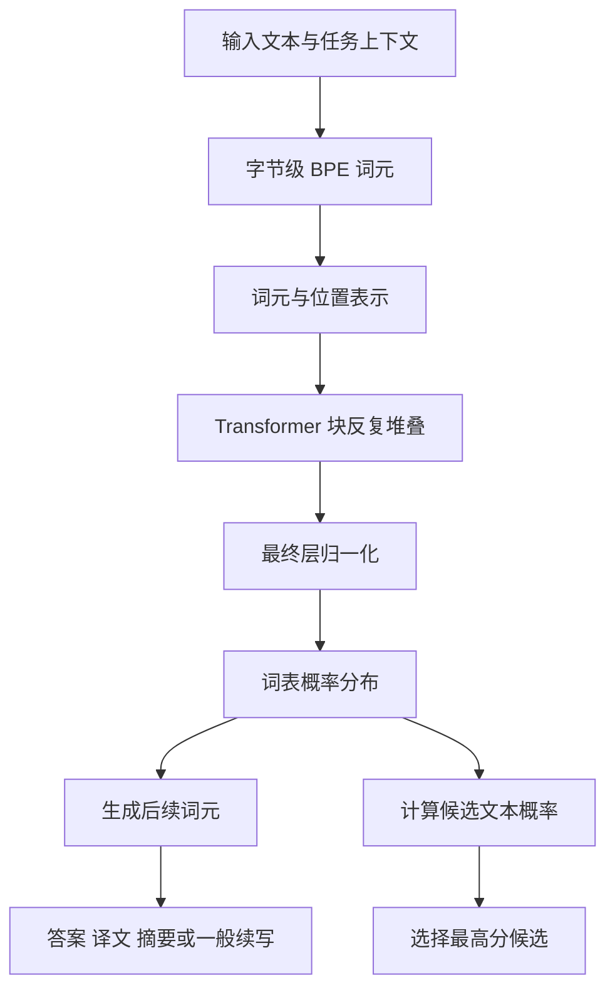

---
aliases:
  - GPT-2模型结构
  - GPT2的模型结构
tags:
  - 知识点
  - GPT
  - 模型架构
updated: 2026-10-10
---

# GPT2模型架构

**GPT2 仍然是基于 Transformer 的自回归语言模型，基本沿用 GPT1 的主体，在层归一化位置、残差初始化、词表、上下文长度和模型规模等方面作了修改。**这份笔记解释模型怎样把文本上下文变为词表概率，以及论文明确给出的架构规格。

本文依据 [[language-models-GPT2.pdf]] 第 2.3 节、表 2 与第 3 节开头整理。结构图和 pre-LN 公式是帮助理解原文的教学表达；规格表保留论文原始数值和口径，不补入正文未列出的实现超参数。嵌入、注意力及前馈网络的基础计算另见 [[GPT1模型架构]]。

## 整体计算图

GPT2 仍使用基于 Transformer 的自回归语言模型，大体沿用 GPT1。没有另一套为摘要或问答单独准备的编码器，也没有为每种任务增加分类输出层。若对嵌入、因果注意力和前馈网络还不熟悉，可以先读 [[GPT1模型架构]]；其中 GPT1 的归一化位置与 GPT2 不同，不能照搬。

下面的图是依据 GPT2 论文第 2.3 节整理的教学示意，**不是论文原有的架构图片**：

它与普通“为每个任务训练一个输出头”的关键区别是：模型输出始终是语言模型概率，任务行为来自上下文和使用方式。

## 归一化移到子块输入：pre-LN

GPT1 笔记中的块，采用“子层计算—残差相加—层归一化”的结构。GPT2 把层归一化移到各子块的输入，通常称为 pre-LN。忽略 dropout，可以用以下教学公式概括：

$$
Y=X+\operatorname{MaskedMHA}(\operatorname{LN}(X)),
$$

$$
Z=Y+\operatorname{FFN}(\operatorname{LN}(Y)).
$$

这样，注意力和前馈子层接收归一化后的输入，残差路径仍保留直接相加。GPT2 论文第 2.3 节还说明，在最终的自注意力块后增加了层归一化。

这些调整与训练更深的网络有关，但 GPT2 论文没有用单独消融实验量化“移动 LayerNorm 本身提高了多少任务分数”。不要把整个 GPT2 的收益全部归因于这一处修改。

## 初始化考虑残差随深度的累积

作者调整初始化，将残差层权重按 $1/\sqrt N$ 缩放，其中 $N$ 是残差层数量。可以把它理解为：网络越深，残差分支累计叠加得越多，初始化时相应控制这些分支的贡献尺度。

这里的 $N$ 不是本文训练数据大小，也不能不加区分地当作 Transformer 块数；一个块内部有多个残差子层。论文正文给出了缩放原则，未展开所有实现细节。

## 其他明确给出的修改

| 项目 | GPT2本文的设置 | 初学者应注意 |
| --- | --- | --- |
| 词表 | 50,257 | 是词元数量，不是英语单词数量 |
| 上下文长度 | 从 512 扩展到 1,024 词元 | 不是 1,024 个汉字或完整词语 |
| batch size | 512 | 不应直接把它解释为每次读取 512 篇完整网页 |
| 学习率选择 | 每个模型人工调节，以 5% WebText 留出集困惑度为依据 | 正文没有列出四个模型的完整学习率数值表 |

GPT2 论文主体没有把所有训练超参数、硬件成本和任务处理实现写全。理解论文方法与精确复现完整系统，是两个不同的阅读目标。

## 四种模型规模

| 参数量（原文口径） | Transformer层数 | 隐藏维度 $d_{\text{model}}$ | 论文中的定位 |
| --- | --- | --- | --- |
| 117M | 12 | 768 | 规模与原始 GPT 相当 |
| 345M | 24 | 1,024 | 规模与 BERT 最大模型相当，架构并不因此相同 |
| 762M | 36 | 1,280 | 中间规模模型 |
| 1,542M | 48 | 1,600 | 作者称为 GPT-2 的最大模型，约 15 亿参数 |

M 表示百万。层数衡量深度，隐藏维度衡量每个位置表示的宽度，参数量还受到词表等组件影响。不能把“48 层”理解成“48 个注意力头”。GPT2 论文表 2 没有列出注意力头数，不应从该表补造头数。

## 与其他笔记的直接关系

- [[GPT1模型架构]]：提供词元与位置嵌入、因果注意力、前馈网络和残差连接的计算基础；对照它的归一化顺序，可以看清 GPT2 的 pre-LN 修改。
- [[字节级BPE分词]]：解释计算图中的输入表示，以及 50,257 个词表词元如何与 256 个基础字节相容。
- [[GPT2的任务设置与实验结果]]：解释同一词表概率输出如何通过生成或候选评分完成不同任务，避免把任务变化误认为增加了任务专属网络。
- [[GPT2的规模效应与欠拟合]]：用四种规模的实验结果检验容量变化带来的收益，并说明架构、数据与训练安排同时变化时的因果边界。
- [[GPT2论文总结]]：把实现选择放回研究动机、自然任务示范和实验验证的完整主线中。

## 原始依据与核对位置

- [[language-models-GPT2.pdf]] 第 2.3 节：Transformer 主体、层归一化位置、最终层归一化、残差初始化缩放、词表、上下文长度和 batch size；表 2 给出四种模型的参数量、层数及隐藏维度。
- [[language-models-GPT2.pdf]] 第 3 节开头：四种容量的设置、最小及第二小模型的规模比较、按 5% WebText 留出集困惑度人工调节学习率。
- [[Language Models are Unsupervised Multitask Learners_完整中文翻译#2.3 模型|译文第 2.3 节]]、[[Language Models are Unsupervised Multitask Learners_完整中文翻译#3 实验|译文第 3 节开头]]：核对架构表和实验训练说明。
