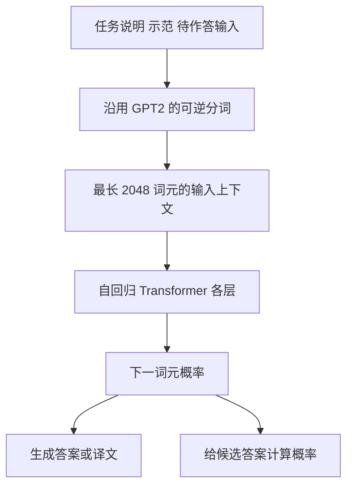

---
aliases:
  - GPT-3模型结构
  - GPT3的模型结构
tags:
  - 知识点
  - GPT
  - 模型架构
updated: 2026-10-11
---

# GPT3模型架构

**GPT3 是自回归 Transformer 语言模型，沿用 GPT2 的前置归一化、残差初始化与可逆分词，并把上下文窗口增至 2,048 个词元；各层交替使用稠密注意力和局部带状稀疏注意力。**论文最大模型为 1,750 亿参数，但少样本任务适应发生在输入上下文中，评估时不更新这些参数。

本文以 [[Language-models-are-few-shot-learners-GPT3.pdf]] 第 2.1 节、表 2.1 与附录 B 为依据。词元嵌入、因果注意力、前馈网络等基础计算复用 [[GPT1模型架构]]；前置归一化与初始化细节复用 [[GPT2模型架构]]，本篇只解释 GPT3 明确给出的继承关系、变化与规格。

## 同一语言模型怎样完成不同任务

GPT3 把输入文本转换成词元，再由 Transformer 计算各位置表示，输出下一词元的概率。任务可以在输入中用文字说明，也可以由示范的输入输出关系表达。问答、翻译、分类并不因此换成三套任务专属网络。

以下是依据论文整理的教学示意，不是论文原图：

生成任务依据概率继续写；多项选择任务比较候选续写概率。因此，“学会一个新任务”在本文评估中指行为随上下文变化，不指再训练一个输出头，也不指在测试时改动参数。相关概念见 [[Zero-Shot与Few-Shot]]。

## 继承 GPT2 的部分

第 2.1 节明确说明，除注意力模式外，模型与架构沿用 GPT2，包括修改后的初始化、前置归一化和可逆分词。GPT2 中的前置归一化把 LayerNorm 放到注意力及前馈子层输入端；初始化缩放考虑残差路径随网络深度累积。这两处的教学公式和边界在 [[GPT2模型架构]] 维护。

可逆分词使模型能够处理任意文本字符串，不需要把未知词替换成一个统一的未知符号。输入单位是词元，可能为一个词、词的一部分、标点或字节组合，不等于完整英语单词。机制见 [[字节级BPE分词]]。GPT3 的翻译实验也提示边界：作者认为复用几乎全英文数据上开发的 GPT2 分词器，可能与英译罗马尼亚语的较弱表现有关；这是作者解释，未通过独立分词器消融证明。

## 注意力变化与上下文长度

论文用“交替的稠密和局部带状稀疏注意力”描述各层的注意力模式，并说它类似 Sparse Transformer。局部带状模式限制某层可连接的位置范围；稠密模式提供更广的连接。它们仍属于自回归语言模型的计算，不能把“稠密”理解为可以在预测时读取未来答案。

论文没有给出局部带宽、所有层的详细掩码矩阵及完整实现代码。因此，上述说明只解释模式的含义，不补造一个看似可直接复现的掩码配置。注意力连接稀疏也不等于 MoE 专家路由或每个词元只激活一部分模型参数；本文没有使用那种专家架构。

所有八种规模的模型都使用 $n_{\text{ctx}}=2048$ 个词元。窗口必须同时容纳任务指令、示范及当前问题所需上下文；长样例能放入的示范更少。因此，论文中的 $K$ 是上下文示范数，不是一个固定的架构超参数。多数任务容纳约 10–100 个示范，SuperGLUE 使用 32 个，CoQA 因上下文长而使用 5 个。

## 八种规模的架构规格

下表保留原论文表 2.1 的数据。M 为百万，B 为十亿；层数、隐藏维度与注意力头数量分别描述不同的结构属性，不能互相替代。

| 模型 | 参数量 | 层数 $n_{\text{layers}}$ | 隐藏维度 $d_{\text{model}}$ | 头数 $n_{\text{heads}}$ | 每头维度 $d_{\text{head}}$ |
| --- | ---: | ---: | ---: | ---: | ---: |
| GPT-3 Small | 125M | 12 | 768 | 12 | 64 |
| GPT-3 Medium | 350M | 24 | 1024 | 16 | 64 |
| GPT-3 Large | 760M | 24 | 1536 | 16 | 96 |
| GPT-3 XL | 1.3B | 24 | 2048 | 24 | 128 |
| GPT-3 2.7B | 2.7B | 32 | 2560 | 32 | 80 |
| GPT-3 6.7B | 6.7B | 32 | 4096 | 32 | 128 |
| GPT-3 13B | 13.0B | 40 | 5140 | 40 | 128 |
| GPT-3 175B，即 GPT-3 | 175.0B | 96 | 12288 | 96 | 128 |

所有模型的前馈层维度为：

$$
d_{\text{ff}}=4d_{\text{model}}.
$$

例如，最大模型对应 $d_{\text{ff}}=4\times12288=49152$；这是根据论文关系式计算的值，不是原表新增的一列实验统计。

> [!warning] 原表的维度不一致
> 13B 行的隐藏维度原文确实为 5140，而 $40\times128=5120$。1.3B 行的 $24\times128=3072$ 也不同于表中的隐藏维度 2048。原文没有解释这些不一致。本篇与完整译文均保留原表，不能把通常的 $d_{\text{model}}=n_{\text{heads}}d_{\text{head}}$ 关系当作核验过的修订依据，也不能据此猜测未公开的实现。

## 模型并行为何影响规格选择

作者沿深度与宽度两个维度将模型分配到 GPU，以减少节点间传输；训练部分进一步说明，矩阵乘法内部的模型并行与跨网络层的模型并行结合使用。各模型的精确架构参数还考虑计算效率和 GPU 布置的负载均衡。

这解释了为什么规模增长并非只把层数按一个倍数放大。它也意味着，表中的规格除了容量考虑，还受训练系统约束。论文未给出完整 GPU 数量、各模型的并行分组及通信调度；复现时不能把这些空缺当作已知配置。

## 架构能说明什么，实验还需说明什么

架构说明模型如何处理文本、能容纳多长上下文、具有多大参数容量。它不能单独证明模型真的从头学会了新任务，也不能证明少样本增益全部由参数量增加造成。训练数据、训练量、上下文格式和评分方法都参与形成结果。

作者训练八种规模，是为了检验验证损失与下游任务表现的规模变化。图 3.1 中还加入了六种更小模型，仅用于语言建模损失的规模分析；不能把它们与正文八种模型的完整任务评估混为一组。

## 原始依据与相关笔记

- [[Language-models-are-few-shot-learners-GPT3.pdf]] 第 2.1 节、表 2.1：GPT2 继承关系、交替注意力、八种模型规格、2,048 词元窗口、前馈维度与模型并行。
- 原论文第 2.3 节、附录 B：并行训练、完整长度序列及文档打包；第 3.3 节：分词器与翻译方向的作者解释。
- [[Language Models are Few-Shot Learners_完整中文翻译#2.1 模型与架构|完整译文第 2.1 节]]：核对原表及维度不一致的译注。
- [[GPT3的训练数据与训练过程]]：解释架构在什么材料上、用何种训练安排学习参数。
- [[GPT3论文总结]]：把架构选择放回上下文学习的研究问题与实验证据中。
