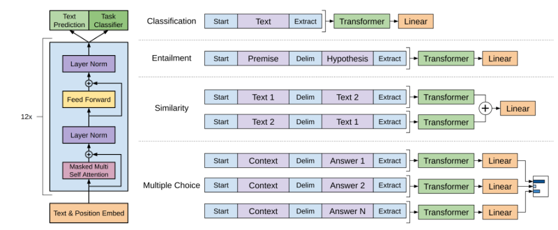
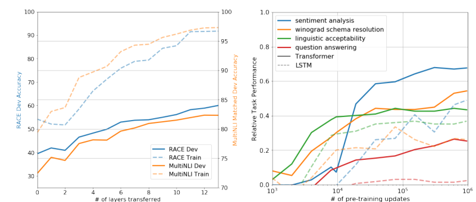

---
tags:
  - 论文翻译
  - GPT
---
# 通过生成式预训练提升语言理解能力

**原题：Improving Language Understanding by Generative Pre-Training**

**作者：** Alec Radford、Karthik Narasimhan、Tim Salimans、Ilya Sutskever  
**机构：** OpenAI  
**电子邮箱：** alec@openai.com；karthikn@openai.com；tim@openai.com；ilyasu@openai.com

**原文状态：** 预印本，研究仍在进行中。

> 翻译说明：本译文依据同目录中的 `language_understanding_paper.pdf`，覆盖全部 12 页的正文、公式、表格、图注、脚注和参考文献。图中文字另附中文对照。方法名、数据集名、人名及文献出处保留可检索的原名，参考文献题名译为中文。原文中的数字或符号不一致处以“译注”标明，未擅自改写实验结果。

## 摘要

自然语言理解涵盖多种不同的任务，例如文本蕴含、问答、语义相似度评估和文档分类。虽然大规模无标注文本语料十分丰富，但用于学习这些具体任务的标注数据却很稀缺，因此，通过判别式训练得到的模型很难取得充分理想的表现。我们证明：先在包含多种内容的无标注文本语料上对语言模型进行生成式预训练，再针对每项具体任务进行判别式微调，可以显著提升这些任务的性能。与以往方法不同，我们在微调时采用面向任务的输入变换，只需对模型架构进行很少的修改，就能实现有效迁移。我们在一系列自然语言理解基准上验证了这一方法的有效性。我们这个通用、与具体任务无关的模型，优于采用专门针对各项任务设计的架构并进行判别式训练的模型，在所研究的 12 项任务中，有 9 项显著刷新了当时的最佳结果。例如，在常识推理（Stories Cloze Test）、问答（RACE）和文本蕴含（MultiNLI）上，我们分别取得了 8.9、5.7 和 1.5 个百分点的绝对提升。

## 1 引言

有效地从原始文本中学习的能力，对于减轻自然语言处理（NLP）对监督学习的依赖至关重要。大多数深度学习方法需要大量人工标注数据，这限制了它们在许多缺乏标注资源的领域中的应用 [61]。在这些情况下，能够利用无标注数据中的语言信息的模型，为收集更多标注提供了一种有价值的替代方案，因为收集标注可能既费时又昂贵。此外，即使已有相当多的监督信息，以无监督方式学习良好的表示，也可以显著提升性能。迄今最有说服力的证据，是预训练词嵌入 [10, 39, 42] 被广泛用于提升多种 NLP 任务的性能 [8, 11, 26, 45]。

然而，要从无标注文本中利用超越词级别的信息，主要面临两个挑战。首先，尚不清楚哪种优化目标最适合学习有助于迁移的文本表示。近期研究考察了语言建模 [44]、机器翻译 [38] 和篇章连贯性 [22] 等不同目标，但在不同任务上，各种方法各有优劣。¹ 其次，对于如何最有效地将学到的表示迁移到目标任务，目前还没有共识。现有技术通常结合了针对具体任务修改模型架构 [43, 44]、使用复杂学习方案 [21]，以及增加辅助学习目标 [50] 等做法。这些不确定性使得为语言处理开发有效的半监督学习方法变得困难。

本文探索一种用于语言理解任务的半监督方法，将无监督预训练与有监督微调相结合。我们的目标是学习一种通用表示，只需很少的适配，就能迁移到广泛的任务中。我们假设可以获得一个大规模无标注文本语料，以及若干包含人工标注训练样本的数据集，即目标任务的数据集。我们的设定不要求这些目标任务与无标注语料来自相同领域。我们采用两阶段训练过程：首先，在无标注数据上使用语言建模目标，学习神经网络模型的初始参数；随后，使用相应的监督目标，将这些参数适配到目标任务。

在模型架构方面，我们使用 Transformer [62]。它已经在机器翻译 [62]、文档生成 [34] 和句法分析 [29] 等任务上表现出色。与循环网络等替代方案相比，这一模型提供了结构更明确的记忆机制，用于处理文本中的长期依赖，因此能够在多种任务上取得稳健的迁移表现。在迁移阶段，我们采用源自遍历式方法 [52] 的任务专用输入适配，将结构化文本输入作为一条连续的词元序列来处理。正如实验所示，这些适配使我们只需对预训练模型架构进行很少的修改，就能有效微调。

我们在四类语言理解任务上评估这一方法：自然语言推断、问答、语义相似度和文本分类。我们这个通用、与具体任务无关的模型，优于采用专门为每项任务设计的架构并进行判别式训练的模型，在所研究的 12 项任务中，有 9 项显著刷新了当时的最佳结果。例如，在常识推理（Stories Cloze Test）[40]、问答（RACE）[30]、文本蕴含（MultiNLI）[66]，以及最近提出的 GLUE 多任务基准 [64] 上，我们分别取得了 8.9、5.7、1.5 和 5.5 个百分点的绝对提升。我们还分析了预训练模型在四种不同设定下的零样本行为，证明它获得了有助于下游任务的语言知识。

¹ https://gluebenchmark.com/leaderboard

> 译注：本段原文报告 GLUE 的绝对提升为 5.5%，但第 4.2 节及表 4 中的分数为 72.8 与 68.9，相差 3.9 分。此处按原文保留。

## 2 相关工作

**NLP 中的半监督学习。** 我们的工作总体上属于自然语言半监督学习。这一范式已经引起广泛关注，并被应用于序列标注 [24, 33, 57] 和文本分类 [41, 70] 等任务。最早的方法利用无标注数据计算词级或短语级统计量，再将这些统计量作为监督模型中的特征 [33]。过去几年中，研究者已经证明，使用在无标注语料上训练的词嵌入 [11, 39, 42]，可以提升多种任务的性能 [8, 11, 26, 45]。然而，这些方法主要迁移词级信息，而我们希望捕获更高层次的语义。

近期的方法研究了如何从无标注数据中学习并利用超越词级别的语义。可以使用无标注语料训练的短语级或句子级嵌入，已经被用于将文本编码为适合各种目标任务的向量表示 [28, 32, 1, 36, 22, 12, 56, 31]。

**无监督预训练。** 无监督预训练是半监督学习的一种特殊情形，其目标是找到良好的初始化点，而不是修改监督学习目标。早期工作探索了这一技术在图像分类 [20, 49, 63] 和回归任务 [3] 中的应用。后续研究 [15] 表明，预训练起到正则化的作用，可以改善深度神经网络的泛化能力。近期，这种方法被用于辅助训练图像分类 [69]、语音识别 [68]、实体消歧 [17] 和机器翻译 [48] 等任务中的深度神经网络。

与我们最接近的一类工作，是先使用语言建模目标预训练神经网络，再在目标任务上使用监督信息进行微调。Dai 等人 [13] 以及 Howard 和 Ruder [21] 采用了这一方法来改善文本分类。然而，尽管预训练阶段有助于捕获一些语言信息，他们使用的 LSTM 模型使其预测能力局限于较短的范围。相比之下，我们选择 Transformer 网络，能够捕获距离更远的语言结构，这一点在实验中得到了验证。此外，我们还证明了模型在更广泛任务上的有效性，包括自然语言推断、复述检测和故事补全。其他方法 [43, 44, 38] 在目标任务上训练监督模型时，将预训练语言模型或机器翻译模型的隐藏表示作为辅助特征。这需要为每个独立的目标任务引入大量新参数，而我们在迁移时只需对模型架构进行很少的修改。

**辅助训练目标。** 添加辅助无监督训练目标，是半监督学习的另一种形式。Collobert 和 Weston 的早期工作 [10] 使用了多种辅助 NLP 任务，例如词性标注、浅层句法分析、命名实体识别和语言建模，以提升语义角色标注的性能。近期，Rei [50] 在目标任务目标中添加辅助语言建模目标，并证明这能提升序列标注任务的性能。我们的实验也使用了辅助目标，但正如我们所展示的，无监督预训练本身已经学到了与目标任务相关的多种语言属性。

## 3 框架

我们的训练过程分为两个阶段。第一阶段是在大规模文本语料上学习一个高容量语言模型。随后进入微调阶段，使用标注数据，将模型适配到判别式任务。

### 3.1 无监督预训练

给定一个无监督词元语料 $U=\{u_1,\ldots,u_n\}$，我们使用标准语言建模目标，最大化以下似然：

$$
L_1(U)=\sum_i\log P(u_i\mid u_{i-k},\ldots,u_{i-1};\Theta). \tag{1}
$$

其中，$k$ 是上下文窗口大小，条件概率 $P$ 由参数为 $\Theta$ 的神经网络建模。这些参数使用随机梯度下降 [51] 进行训练。

在实验中，我们使用多层 Transformer 解码器 [34] 作为语言模型，它是 Transformer [62] 的一种变体。该模型先对输入上下文中的词元执行多头自注意力操作，再经过逐位置前馈层，生成目标词元上的输出分布：

$$
\begin{aligned}
h_0&=UW_e+W_p,\\
h_l&=\operatorname{transformer\_block}(h_{l-1}),\quad l\in[1,n],\\
P(u)&=\operatorname{softmax}(h_nW_e^T).
\end{aligned} \tag{2}
$$

其中，$U=(u_{-k},\ldots,u_{-1})$ 是上下文词元向量，$n$ 是层数，$W_e$ 是词元嵌入矩阵，$W_p$ 是位置嵌入矩阵。

> 译注：原文公式 (2) 第二行的范围变量印为 $i$，但隐藏状态下标使用 $l$；这里统一写为 $l$。原文在语料定义和模型层数中分别使用了 $n$，其含义由上下文区分。

### 3.2 有监督微调

使用公式 (1) 的目标训练模型之后，我们将参数适配到有监督目标任务。假设有一个标注数据集 $C$，其中每个样本由输入词元序列 $x_1,\ldots,x_m$ 和标签 $y$ 构成。我们将输入送入预训练模型，取得最后一个 Transformer 块的激活值 $h_l^m$，随后将其送入新增的、参数为 $W_y$ 的线性输出层，以预测 $y$：

$$
P(y\mid x_1,\ldots,x_m)=\operatorname{softmax}(h_l^mW_y). \tag{3}
$$

由此得到以下需要最大化的目标：

$$
L_2(C)=\sum_{(x,y)}\log P(y\mid x_1,\ldots,x_m). \tag{4}
$$

此外，我们发现，在微调时将语言建模作为辅助目标，可以通过两种方式帮助学习：（a）改善监督模型的泛化能力；（b）加快收敛。这与此前的工作 [50, 43] 一致，它们同样观察到此类辅助目标能够提升性能。具体而言，我们优化如下目标，其中 $\lambda$ 为权重：

$$
L_3(C)=L_2(C)+\lambda L_1(C). \tag{5}
$$

总体而言，微调时唯一需要增加的参数是 $W_y$，以及分隔词元的嵌入，后者将在第 3.3 节介绍。

**图 1：** 左图展示本文使用的 Transformer 架构与训练目标。右图展示不同任务在微调时采用的输入变换。我们将所有结构化输入转换为词元序列，由预训练模型处理，随后经过线性层与 softmax 层。

**图 1 图中文字中文对照：** Text Prediction 为“文本预测”；Task Classifier 为“任务分类器”；Transformer 为“Transformer”；12x 为“重复 12 次”；Layer Norm 为“层归一化”；Feed Forward 为“前馈网络”；Masked Multi Self Attention 为“带掩码的多头自注意力”；Text & Position Embed 为“文本嵌入与位置嵌入”；Classification 为“分类”；Entailment 为“蕴含”；Similarity 为“相似度”；Multiple Choice 为“多项选择”；Start 为“开始”；Extract 为“提取”；Delim 为“分隔”；Text 为“文本”；Premise 为“前提”；Hypothesis 为“假设”；Text 1/2 为“文本 1/2”；Context 为“上下文”；Answer 1/2/N 为“答案 1/2/N”；Linear 为“线性层”。相似度分支中的“+”表示两个序列表示相加，Transformer 块内的“+”表示残差相加。

### 3.3 针对具体任务的输入变换

对于文本分类等任务，可以直接按上述方式微调模型。另一些任务，例如问答或文本蕴含，则具有结构化输入，如有顺序的句子对，或者由文档、问题和答案组成的三元组。由于预训练模型是在连续文本序列上训练的，要将其应用于这些任务，需要进行一些调整。

此前的工作提出，在迁移来的表示之上学习任务专用架构 [44]。这一方法重新引入了大量针对具体任务的定制，而且没有对这些新增架构组件使用迁移学习。我们则采用遍历式方法 [52]，将结构化输入转换为预训练模型可以处理的有序序列。这些输入变换使我们无需在不同任务之间大幅修改架构。下面简要介绍这些输入变换，图 1 给出了直观示意。所有变换都包括添加随机初始化的开始词元和结束词元，即 $\langle s\rangle$ 与 $\langle e\rangle$。

**文本蕴含。** 对于蕴含任务，我们将前提 $p$ 和假设 $h$ 的词元序列拼接起来，在二者之间插入分隔词元（$\$$）。

**相似度。** 对于相似度任务，被比较的两个句子之间没有内在顺序。为体现这一点，我们构造包含两种可能句子顺序的输入序列，句子之间插入分隔词元，并分别独立处理这两种顺序，得到两个序列表示 $h_l^m$。在将它们送入线性输出层之前，先逐元素相加。

**问答与常识推理。** 对于这些任务，给定上下文文档 $z$、问题 $q$ 和一组候选答案 $\{a_k\}$。我们将文档上下文与问题同每个候选答案拼接，并在中间插入分隔词元，得到 $[z;q;\$;a_k]$。模型分别独立处理这些序列，再通过 softmax 层进行归一化，得到候选答案上的输出分布。

## 4 实验

### 4.1 实验设置

**无监督预训练。** 我们使用 BooksCorpus 数据集 [71] 训练语言模型。它包含超过 7,000 本各不相同、尚未出版的书籍，涵盖冒险、奇幻、爱情等多种类型。关键在于，它包含长段连续文本，使生成模型能够学会以长距离信息为条件进行预测。另一种可选数据集是 1B Word Benchmark，类似方法 ELMo [44] 使用了这一数据集。它与 BooksCorpus 的规模大致相当，但在句子级别进行了打乱，破坏了长距离结构。我们的语言模型在这一语料上取得了很低的词元级困惑度，为 18.4。

> 译注：“这一语料”按原文保留；该段前一句提及作为比较的 1B Word Benchmark，而本节明确指定的实际预训练数据集是 BooksCorpus。

**表 1：实验使用的不同任务与数据集。**

| 任务     | 数据集                                                                   |
| ------ | --------------------------------------------------------------------- |
| 自然语言推断 | SNLI [5]、MultiNLI [66]、Question NLI [64]、RTE [4]、SciTail [25]         |
| 问答     | RACE [30]、Story Cloze [40]                                            |
| 句子相似度  | MSR Paraphrase Corpus [14]、Quora Question Pairs [9]、STS Benchmark [6] |
| 分类     | Stanford Sentiment Treebank-2 [54]、CoLA [65]                          |

**模型规格。** 我们的模型基本遵循最初的 Transformer 工作 [62]。我们训练了一个包含 12 层、仅由解码器组成的 Transformer，使用带掩码的自注意力头，状态维度为 768，注意力头数为 12。对于逐位置前馈网络，我们使用 3,072 维的内部状态。我们采用 Adam 优化方案 [27]，最大学习率为 $2.5\times10^{-4}$。在最初 2,000 次更新中，学习率从零线性增加，随后按余弦调度退火到零。我们训练 100 个轮次，每个小批次包含 64 条随机采样的连续序列，每条序列长度为 512 个词元。由于模型中广泛使用了层归一化 [2]，简单地采用 $\mathcal N(0,0.02)$ 进行权重初始化便已足够。我们使用经过 40,000 次合并的字节对编码（BPE）词表 [53]，并在残差、嵌入和注意力中使用比率为 0.1 的 dropout 进行正则化。我们还采用了文献 [37] 提出的修改版 L2 正则化，对所有非偏置、非增益权重设定 $w=0.01$。激活函数使用高斯误差线性单元（GELU）[18]。我们使用学习得到的位置嵌入，而非最初工作中提出的正弦位置嵌入。

我们使用 ftfy 库² 清理 BooksCorpus 中的原始文本，对部分标点和空白字符进行标准化，并使用 spaCy 分词器。³

**微调细节。** 除非另有说明，我们复用无监督预训练阶段的超参数设置。在分类器中加入比率为 0.1 的 dropout。对于大多数任务，我们使用 $6.25\times10^{-5}$ 的学习率，批次大小为 32。模型微调速度很快，大多数情况下训练 3 个轮次便已足够。我们采用线性学习率衰减调度，并在训练的前 0.2% 进行预热。$\lambda$ 设为 0.5。

² https://ftfy.readthedocs.io/en/latest/  
³ https://spacy.io/

### 4.2 有监督微调

我们在多种有监督任务上进行实验，包括自然语言推断、问答、语义相似度和文本分类。其中一些任务属于最近发布的 GLUE 多任务基准 [64]，我们使用了该基准。图 1 概览了所有任务与数据集。

> 译注：此处“图 1”按原文保留；列出任务和数据集的是表 1，图 1 展示的是模型架构及任务输入变换。

**自然语言推断。** 自然语言推断（NLI），又称文本蕴含识别，要求读取一对句子，并判断二者关系属于“蕴含”“矛盾”还是“中立”。尽管近期研究对此表现出很大兴趣 [58, 35, 44]，但由于涉及词汇蕴含、共指，以及词汇和句法歧义等多种现象，这一任务仍然具有挑战性。我们在五个来源各异的数据集上进行评估，包括图像描述（SNLI）、转写的口语、通俗小说与政府报告（MNLI）、维基百科文章（QNLI）、科学考试（SciTail），以及新闻文章（RTE）。

> 译注：上述三分类是对自然语言推断的概述，并非表 1 中所有相关数据集的统一标签设置；QNLI、RTE、SciTail 使用二分类任务设置。各类示例见 [[GPT1的文本蕴含相似度与问答任务]]。

表 2 详细列出了我们的模型与此前最佳方法在不同 NLI 任务上的结果。我们的方法在五个数据集中的四个上显著优于基线：相对于此前的最佳结果，在 MNLI、SciTail、QNLI 和 SNLI 上分别取得了最高 1.5、5、5.8 和 0.6 个百分点的绝对提升。这说明我们的模型能够更好地对多个句子进行推理，并处理语言歧义。在我们评估的较小数据集之一 RTE 上，训练样本为 2,490 个，我们取得了 56% 的准确率，低于多任务双向 LSTM 模型报告的 61.7%。考虑到我们的方法在较大 NLI 数据集上的出色表现，模型很可能也能从多任务训练中受益，但目前尚未对此展开探索。

**表 2：自然语言推断任务的实验结果，将我们的模型与当时的最佳方法进行比较。5× 表示由 5 个模型组成的集成。所有数据集均使用准确率作为评估指标。**

| 方法 | MNLI-m | MNLI-mm | SNLI | SciTail | QNLI | RTE |
| --- | ---: | ---: | ---: | ---: | ---: | ---: |
| ESIM + ELMo [44]（5×） | - | - | 89.3 | - | - | - |
| CAFE [58]（5×） | 80.2 | 79.0 | 89.3 | - | - | - |
| Stochastic Answer Network [35]（3×） | 80.6 | 80.1 | - | - | - | - |
| CAFE [58] | 78.7 | 77.9 | 88.5 | 83.3 | - | - |
| GenSen [64] | 71.4 | 71.3 | - | - | 82.3 | 59.2 |
| 多任务 BiLSTM + Attn [64] | 72.2 | 72.1 | - | - | 82.1 | 61.7 |
| 微调后的 Transformer 语言模型（我们的方法） | **82.1** | **81.4** | **89.9** | **88.3** | **88.1** | 56.0 |

**表 3：问答与常识推理的结果，将我们的模型与当时的最佳方法进行比较。9× 表示由 9 个模型组成的集成。**

| 方法 | Story Cloze | RACE-m | RACE-h | RACE |
| --- | ---: | ---: | ---: | ---: |
| val-LS-skip [55] | 76.5 | - | - | - |
| Hidden Coherence Model [7] | 77.6 | - | - | - |
| Dynamic Fusion Net [67]（9×） | - | 55.6 | 49.4 | 51.2 |
| BiAttention MRU [59]（9×） | - | 60.2 | 50.3 | 53.3 |
| 微调后的 Transformer 语言模型（我们的方法） | **86.5** | **62.9** | **57.4** | **59.0** |

**问答与常识推理。** 问答也是一项需要单句与多句推理能力的任务。我们使用最近发布的 RACE 数据集 [30]，它由初中和高中考试中的英语文章及其对应问题构成。已有研究表明，相较于 CNN [19] 或 SQuAD [47] 等其他数据集，这一语料包含更多推理类问题，因此非常适合评估我们这个经过训练、能够处理长距离上下文的模型。此外，我们还在 Story Cloze Test [40] 上进行评估，这一任务要求从两个选项中，为由多个句子组成的故事选择正确结局。在这些任务上，我们的模型再次大幅超越此前的最佳结果：在 Story Cloze 上提升了最高 8.9 个百分点，在 RACE 总体结果上提升了 5.7 个百分点。这说明我们的模型能够有效处理长距离上下文。

**语义相似度。** 语义相似度任务，或称复述检测任务，要求预测两个句子是否在语义上等价。挑战在于识别对概念的不同表达、理解否定，以及处理句法歧义。我们使用三个数据集：从新闻来源收集的 Microsoft Paraphrase Corpus（MRPC）[14]、Quora Question Pairs（QQP）[9]，以及 Semantic Textual Similarity Benchmark（STS-B）[6]。在三项语义相似度任务中，我们在两项上取得了当时的最佳结果（表 4），其中 STS-B 取得了 1 分的绝对提升。QQP 上的性能差异较为显著，相对于单任务 BiLSTM + ELMo + Attn，取得了 4.2 个百分点的绝对提升。

> 译注：本段概述将相似度任务与复述检测并列，但 STS-B 预测的是连续相似度分数，并非只判断语义是否等价；MRPC 与 QQP 才是相应的二分类任务。

**分类。** 最后，我们还在两项不同的文本分类任务上进行评估。Corpus of Linguistic Acceptability（CoLA）[65] 包含专家对句子是否符合语法的判断，用于检验训练模型所具有的内在语言归纳偏置。Stanford Sentiment Treebank（SST-2）[54] 则是一项标准二分类任务。我们的模型在 CoLA 上取得 45.4 分，相对于此前的最佳结果 35.0，是一次尤其显著的提升，展示了模型学到的内在语言归纳偏置。模型在 SST-2 上还取得了 91.3% 的准确率，与当时的最佳结果具有竞争力。我们在 GLUE 基准上的总分为 72.8，显著优于此前的最佳分数 68.9。

**表 4：语义相似度与分类结果，将我们的模型与当时的最佳方法进行比较。本表中所有任务均通过 GLUE 基准进行评估。mc 为 Matthews 相关系数，acc 为准确率，pc 为 Pearson 相关系数。**

| 方法 | CoLA（mc） | SST2（acc） | MRPC（F1） | STSB（pc） | QQP（F1） | GLUE |
| --- | ---: | ---: | ---: | ---: | ---: | ---: |
| Sparse byte mLSTM [16] | - | 93.2 | - | - | - | - |
| TF-KLD [23] | - | - | 86.0 | - | - | - |
| ECNU（混合集成）[60] | - | - | - | 81.0 | - | - |
| 单任务 BiLSTM + ELMo + Attn [64] | 35.0 | 90.2 | 80.2 | 55.5 | 66.1 | 64.8 |
| 多任务 BiLSTM + ELMo + Attn [64] | 18.9 | 91.6 | 83.5 | 72.8 | 63.3 | 68.9 |
| 微调后的 Transformer 语言模型（我们的方法） | **45.4** | 91.3 | 82.3 | **82.0** | **70.3** | **72.8** |

总体而言，我们的方法在所评估的 12 个数据集中，有 9 个取得了新的最佳结果，而且在许多情况下超过了集成模型。结果还表明，我们的方法能够适用于不同规模的数据集，从较小的 STS-B（约 5,700 个训练样本），直到最大的 SNLI（约 550,000 个训练样本）。

## 5 分析

**迁移层数的影响。** 我们考察了从无监督预训练阶段迁移不同数量的层到有监督目标任务时产生的影响。图 2 左图展示了我们的方法在 MultiNLI 和 RACE 上的性能如何随迁移层数变化。我们观察到一个常见结果：迁移嵌入可以提升性能，而每增加一个 Transformer 层，都会带来进一步收益；在 MultiNLI 上，完整迁移时的提升最高达到 9%。这说明预训练模型中的每一层，都包含有助于解决目标任务的功能。

**图 2：** 左图展示从预训练语言模型迁移越来越多的层，对 RACE 和 MultiNLI 的影响。右图展示不同任务上的零样本性能，如何随语言模型预训练的更新次数变化。每项任务的性能在随机猜测基线与当时最佳单模型结果之间进行了归一化。

**图 2 图中文字中文对照：** 左图横轴 `# of layers transferred` 为“迁移层数”，左纵轴 `RACE Dev Accuracy` 为“RACE 开发集准确率”，右纵轴 `MultiNLI Dev Accuracy` 为“MultiNLI 开发集准确率”；图例 `RACE Dev`、`RACE Train`、`MultiNLI Dev`、`MultiNLI Train` 分别为“RACE 开发集”“RACE 训练集”“MultiNLI 开发集”“MultiNLI 训练集”。右图横轴 `# of pre-training updates` 为“预训练更新次数”，纵轴 `Relative Zero-shot Performance` 为“相对零样本性能”；图例 `sentiment analysis` 为“情感分析”，`winograd schema resolution` 为“Winograd 模式解析”，`linguistic acceptability` 为“语言可接受性”，`question answering` 为“问答”。Transformer 曲线为实线，LSTM 曲线为虚线。

**零样本行为。** 我们希望更好地理解，为什么对 Transformer 进行语言模型预训练是有效的。一种假设是，底层生成模型为了提升其语言建模能力，学会了完成我们所评估的许多任务；同时，与 LSTM 相比，Transformer 中结构更明确的注意力记忆有助于迁移。我们设计了一系列启发式方案，利用底层生成模型，在不进行有监督微调的情况下完成任务。图 2 右图展示了这些启发式方案在生成式预训练过程中的效果变化。我们观察到，这些启发式方案的性能较为稳定，并随训练持续提升，这表明生成式预训练有助于学习多种与任务相关的功能。我们还观察到，LSTM 的零样本性能具有更大的方差，说明 Transformer 架构的归纳偏置有助于迁移。

对于 CoLA（语言可接受性），我们以生成模型为样本分配的平均词元对数概率作为得分，并通过设定阈值进行预测。对于 SST-2（情感分析），我们在每个样本末尾添加词元 `very`，将语言模型的输出分布限制为 `positive` 和 `negative` 两个词，并选择模型赋予更高概率的词作为预测。对于 RACE（问答），我们以文档和问题为条件，选择生成模型赋予最高平均词元对数概率的答案。对于 DPRD [46]（Winograd 模式），我们将定指代词分别替换为两个可能的指代对象，再比较替换之后序列剩余部分的平均词元对数概率，选择生成模型赋予更高概率的指代解析结果。

**表 5：不同任务上的模型消融分析。平均分是所有结果的无权重平均值。mc 为 Matthews 相关系数，acc 为准确率，pc 为 Pearson 相关系数。**

| 方法 | 平均分 | CoLA（mc） | SST2（acc） | MRPC（F1） | STSB（pc） | QQP（F1） | MNLI（acc） | QNLI（acc） | RTE（acc） |
| --- | ---: | ---: | ---: | ---: | ---: | ---: | ---: | ---: | ---: |
| 带辅助语言建模目标的 Transformer（完整模型） | 74.7 | 45.4 | 91.3 | 82.3 | 82.0 | 70.3 | 81.8 | 88.1 | 56.0 |
| 未经预训练的 Transformer | 59.9 | 18.9 | 84.0 | 79.4 | 30.9 | 65.5 | 75.7 | 71.2 | 53.8 |
| 不带辅助语言建模目标的 Transformer | 75.0 | 47.9 | 92.0 | 84.9 | 83.2 | 69.8 | 81.1 | 86.9 | 54.4 |
| 带辅助语言建模目标的 LSTM | 69.1 | 30.3 | 90.5 | 83.2 | 71.8 | 68.1 | 73.7 | 81.1 | 54.6 |

**消融研究。** 我们进行了三项不同的消融研究（表 5）。首先，考察在微调时去除辅助语言模型目标后，方法的表现如何。我们观察到，辅助目标对 NLI 任务和 QQP 有帮助。总体趋势表明，较大数据集会从辅助目标中受益，而较小数据集则不会。其次，我们在相同框架下，使用一个包含 2,048 个单元的单层 LSTM 与 Transformer 比较，以分析 Transformer 的作用。使用 LSTM 替代 Transformer 时，平均分下降了 5.6 分。LSTM 仅在一个数据集，即 MRPC 上优于 Transformer。最后，我们还与不经过预训练、直接在有监督目标任务上训练的 Transformer 架构进行了比较。我们观察到，缺少预训练会损害所有任务的性能，相对于完整模型，下降了 14.8%。

> 译注：最后一句的“14.8%”按原文保留。表 5 中平均分由 74.7 降至 59.9，差值为 14.8 分；若计算相对降幅，则约为 19.8%。同样，本节关于完整迁移提升“9%”的表述也沿用原文。

## 6 结论

我们提出了一个框架，通过生成式预训练与判别式微调，使用单一、与具体任务无关的模型，实现了出色的自然语言理解能力。通过在包含长段连续文本、内容多样的语料上进行预训练，模型获得了相当丰富的世界知识，以及处理长距离依赖的能力。这些能力随后成功迁移到了问答、语义相似度评估、蕴含判断和文本分类等判别式任务中，在所研究的 12 个数据集中，有 9 个刷新了当时的最佳结果。利用无监督（预）训练提升判别式任务的性能，长期以来一直是机器学习研究的重要目标。我们的工作表明，显著提升性能确实是可能的，并为哪些模型（Transformer）和数据集（具有长距离依赖的文本）最适合这一方法提供了线索。我们希望，这项工作能够推动自然语言理解及其他领域中有关无监督学习的新研究，进一步加深我们对无监督学习如何起作用、以及何时起作用的理解。

## 参考文献

以下保留原文的编号、作者、年份、出处、页码和标识符，文献题名译为中文。

[1] S. Arora, Y. Liang, and T. Ma. 一种简单却难以超越的句子嵌入基线。2016。

[2] J. L. Ba, J. R. Kiros, and G. E. Hinton. 层归一化。arXiv 预印本 arXiv:1607.06450，2016。

[3] Y. Bengio, P. Lamblin, D. Popovici, and H. Larochelle. 深度网络的贪心逐层训练。载于 *Advances in Neural Information Processing Systems*，第 153–160 页，2007。

[4] L. Bentivogli, P. Clark, I. Dagan, and D. Giampiccolo. 第五届 PASCAL 文本蕴含识别挑战。载于 *TAC*，2009。

[5] S. R. Bowman, G. Angeli, C. Potts, and C. D. Manning. 用于学习自然语言推断的大规模标注语料。*EMNLP*，2015。

[6] D. Cer, M. Diab, E. Agirre, I. Lopez-Gazpio, and L. Specia. SemEval-2017 任务 1：语义文本相似度——侧重多语言与跨语言的评估。arXiv 预印本 arXiv:1708.00055，2017。

[7] S. Chaturvedi, H. Peng, and D. Roth. 通过故事理解预测接下来发生的事情。载于 *Proceedings of the 2017 Conference on Empirical Methods in Natural Language Processing*，第 1603–1614 页，2017。

[8] D. Chen and C. Manning. 使用神经网络的快速、准确依存句法分析器。载于 *Proceedings of the 2014 Conference on Empirical Methods in Natural Language Processing (EMNLP)*，第 740–750 页，2014。

[9] Z. Chen, H. Zhang, X. Zhang, and L. Zhao. Quora 问题对。https://data.quora.com/First-Quora-Dataset-Release-Question-Pairs ，2018。

[10] R. Collobert and J. Weston. 自然语言处理的统一架构：采用多任务学习的深度神经网络。载于 *Proceedings of the 25th International Conference on Machine Learning*，第 160–167 页。ACM，2008。

[11] R. Collobert, J. Weston, L. Bottou, M. Karlen, K. Kavukcuoglu, and P. Kuksa. （几乎）从零开始的自然语言处理。*Journal of Machine Learning Research*，12(Aug):2493–2537，2011。

[12] A. Conneau, D. Kiela, H. Schwenk, L. Barrault, and A. Bordes. 从自然语言推断数据中有监督地学习通用句子表示。*EMNLP*，2017。

[13] A. M. Dai and Q. V. Le. 半监督序列学习。载于 *Advances in Neural Information Processing Systems*，第 3079–3087 页，2015。

[14] W. B. Dolan and C. Brockett. 自动构建句子复述语料。载于 *Proceedings of the Third International Workshop on Paraphrasing (IWP2005)*，2005。

[15] D. Erhan, Y. Bengio, A. Courville, P.-A. Manzagol, P. Vincent, and S. Bengio. 为什么无监督预训练有助于深度学习？*Journal of Machine Learning Research*，11(Feb):625–660，2010。

[16] S. Gray, A. Radford, and K. P. Diederik. 用于块稀疏权重的 GPU 内核。2017。

[17] Z. He, S. Liu, M. Li, M. Zhou, L. Zhang, and H. Wang. 为实体消歧学习实体表示。载于 *Proceedings of the 51st Annual Meeting of the Association for Computational Linguistics (Volume 2: Short Papers)*，第 2 卷，第 30–34 页，2013。

[18] D. Hendrycks and K. Gimpel. 通过高斯误差线性单元连接非线性函数与随机正则化器。arXiv 预印本 arXiv:1606.08415，2016。

[19] K. M. Hermann, T. Kocisky, E. Grefenstette, L. Espeholt, W. Kay, M. Suleyman, and P. Blunsom. 教机器阅读和理解。载于 *Advances in Neural Information Processing Systems*，第 1693–1701 页，2015。

[20] G. E. Hinton, S. Osindero, and Y.-W. Teh. 深度信念网络的快速学习算法。*Neural Computation*，18(7):1527–1554，2006。

[21] J. Howard and S. Ruder. 用于文本分类的通用语言模型微调。*Association for Computational Linguistics (ACL)*，2018。

[22] Y. Jernite, S. R. Bowman, and D. Sontag. 用于快速无监督句子表示学习的篇章目标。arXiv 预印本 arXiv:1705.00557，2017。

[23] Y. Ji and J. Eisenstein. 对分布式句子相似度的判别式改进。载于 *Proceedings of the 2013 Conference on Empirical Methods in Natural Language Processing*，第 891–896 页，2013。

[24] F. Jiao, S. Wang, C.-H. Lee, R. Greiner, and D. Schuurmans. 用于改进序列分割与标注的半监督条件随机场。载于 *Proceedings of the 21st International Conference on Computational Linguistics and the 44th Annual Meeting of the Association for Computational Linguistics*，第 209–216 页。Association for Computational Linguistics，2006。

[25] T. Khot, A. Sabharwal, and P. Clark. SciTail：源自科学问答的文本蕴含数据集。载于 *Proceedings of AAAI*，2018。

[26] Y. Kim. 用于句子分类的卷积神经网络。*EMNLP*，2014。

[27] D. P. Kingma and J. Ba. Adam：一种随机优化方法。arXiv 预印本 arXiv:1412.6980，2014。

[28] R. Kiros, Y. Zhu, R. R. Salakhutdinov, R. Zemel, R. Urtasun, A. Torralba, and S. Fidler. Skip-thought 向量。载于 *Advances in Neural Information Processing Systems*，第 3294–3302 页，2015。

[29] N. Kitaev and D. Klein. 使用自注意力编码器进行成分句法分析。*ACL*，2018。

[30] G. Lai, Q. Xie, H. Liu, Y. Yang, and E. Hovy. RACE：来自考试的大规模阅读理解数据集。*EMNLP*，2017。

[31] G. Lample, L. Denoyer, and M. Ranzato. 仅使用单语语料的无监督机器翻译。*ICLR*，2018。

[32] Q. Le and T. Mikolov. 句子与文档的分布式表示。载于 *International Conference on Machine Learning*，第 1188–1196 页，2014。

[33] P. Liang. 自然语言的半监督学习。博士学位论文，Massachusetts Institute of Technology，2005。

[34] P. J. Liu, M. Saleh, E. Pot, B. Goodrich, R. Sepassi, L. Kaiser, and N. Shazeer. 通过对长序列进行摘要生成维基百科文章。*ICLR*，2018。

[35] X. Liu, K. Duh, and J. Gao. 用于自然语言推断的随机答案网络。arXiv 预印本 arXiv:1804.07888，2018。

[36] L. Logeswaran and H. Lee. 用于学习句子表示的高效框架。*ICLR*，2018。

[37] I. Loshchilov and F. Hutter. 修正 Adam 中的权重衰减正则化。arXiv 预印本 arXiv:1711.05101，2017。

[38] B. McCann, J. Bradbury, C. Xiong, and R. Socher. 从翻译中学习：上下文化词向量。载于 *Advances in Neural Information Processing Systems*，第 6297–6308 页，2017。

[39] T. Mikolov, I. Sutskever, K. Chen, G. S. Corrado, and J. Dean. 词和短语的分布式表示及其组合性。载于 *Advances in Neural Information Processing Systems*，第 3111–3119 页，2013。

[40] N. Mostafazadeh, M. Roth, A. Louis, N. Chambers, and J. Allen. LSDSem 2017 共享任务：故事完形填空测试。载于 *Proceedings of the 2nd Workshop on Linking Models of Lexical, Sentential and Discourse-level Semantics*，第 46–51 页，2017。

[41] K. Nigam, A. McCallum, and T. Mitchell. 使用 EM 的半监督文本分类。*Semi-Supervised Learning*，第 33–56 页，2006。

[42] J. Pennington, R. Socher, and C. Manning. GloVe：用于词表示的全局向量。载于 *Proceedings of the 2014 Conference on Empirical Methods in Natural Language Processing (EMNLP)*，第 1532–1543 页，2014。

[43] M. E. Peters, W. Ammar, C. Bhagavatula, and R. Power. 使用双向语言模型进行半监督序列标注。*ACL*，2017。

[44] M. E. Peters, M. Neumann, M. Iyyer, M. Gardner, C. Clark, K. Lee, and L. Zettlemoyer. 深度上下文化词表示。*NAACL*，2018。

[45] Y. Qi, D. S. Sachan, M. Felix, S. J. Padmanabhan, and G. Neubig. 预训练词嵌入何时以及为何对神经机器翻译有用？*NAACL*，2018。

[46] A. Rahman and V. Ng. 解析定指代词的复杂情形：Winograd 模式挑战。载于 *Proceedings of the 2012 Joint Conference on Empirical Methods in Natural Language Processing and Computational Natural Language Learning*，第 777–789 页。Association for Computational Linguistics，2012。

[47] P. Rajpurkar, J. Zhang, K. Lopyrev, and P. Liang. SQuAD：用于机器文本理解的 100,000 多个问题。*EMNLP*，2016。

[48] P. Ramachandran, P. J. Liu, and Q. V. Le. 用于序列到序列学习的无监督预训练。arXiv 预印本 arXiv:1611.02683，2016。

[49] M. Ranzato, C. Poultney, S. Chopra, and Y. LeCun. 使用基于能量的模型高效学习稀疏表示。载于 *Advances in Neural Information Processing Systems*，第 1137–1144 页，2007。

[50] M. Rei. 用于序列标注的半监督多任务学习。*ACL*，2017。

[51] H. Robbins and S. Monro. 一种随机逼近方法。*The Annals of Mathematical Statistics*，第 400–407 页，1951。

[52] T. Rocktäschel, E. Grefenstette, K. M. Hermann, T. Kočiský, and P. Blunsom. 使用神经注意力推理文本蕴含。arXiv 预印本 arXiv:1509.06664，2015。

[53] R. Sennrich, B. Haddow, and A. Birch. 使用子词单元对罕见词进行神经机器翻译。arXiv 预印本 arXiv:1508.07909，2015。

[54] R. Socher, A. Perelygin, J. Wu, J. Chuang, C. D. Manning, A. Ng, and C. Potts. 在情感树库上学习语义组合性的递归深度模型。载于 *Proceedings of the 2013 Conference on Empirical Methods in Natural Language Processing*，第 1631–1642 页，2013。

[55] S. Srinivasan, R. Arora, and M. Riedl. 一种用于故事完形填空测试的简单有效方法。arXiv 预印本 arXiv:1803.05547，2018。

[56] S. Subramanian, A. Trischler, Y. Bengio, and C. J. Pal. 通过大规模多任务学习获得通用分布式句子表示。arXiv 预印本 arXiv:1804.00079，2018。

[57] J. Suzuki and H. Isozaki. 使用十亿词规模无标注数据进行半监督序列标注与分割。*Proceedings of ACL-08: HLT*，第 665–673 页，2008。

[58] Y. Tay, L. A. Tuan, and S. C. Hui. 用于自然语言推断的带对齐因子分解的比较传播架构。arXiv 预印本 arXiv:1801.00102，2017。

[59] Y. Tay, L. A. Tuan, and S. C. Hui. 用于机器阅读理解的多范围推理。arXiv 预印本 arXiv:1803.09074，2018。

[60] J. Tian, Z. Zhou, M. Lan, and Y. Wu. ECNU 在 SemEval-2017 任务 1 中的工作：利用基于核的传统 NLP 特征与神经网络，构建适用于多语言和跨语言语义文本相似度的通用模型。载于 *Proceedings of the 11th International Workshop on Semantic Evaluation (SemEval-2017)*，第 191–197 页，2017。

[61] Y. Tsvetkov. 低资源语言研究中的机遇与挑战。CMU，2017。

[62] A. Vaswani, N. Shazeer, N. Parmar, J. Uszkoreit, L. Jones, A. N. Gomez, Ł. Kaiser, and I. Polosukhin. 注意力就是你所需要的一切。载于 *Advances in Neural Information Processing Systems*，第 6000–6010 页，2017。

[63] P. Vincent, H. Larochelle, Y. Bengio, and P.-A. Manzagol. 使用去噪自动编码器提取并组合稳健特征。载于 *Proceedings of the 25th International Conference on Machine Learning*，第 1096–1103 页。ACM，2008。

[64] A. Wang, A. Singh, J. Michael, F. Hill, O. Levy, and S. R. Bowman. GLUE：用于自然语言理解的多任务基准与分析平台。arXiv 预印本 arXiv:1804.07461，2018。

[65] A. Warstadt, A. Singh, and S. R. Bowman. 语言可接受性语料。http://nyu-mll.github.io/cola ，2018。

[66] A. Williams, N. Nangia, and S. R. Bowman. 通过推断进行句子理解的广覆盖挑战语料。*NAACL*，2018。

[67] Y. Xu, J. Liu, J. Gao, Y. Shen, and X. Liu. 迈向人类水平的机器阅读理解：采用多种策略进行推理与推断。arXiv 预印本 arXiv:1711.04964，2017。

[68] D. Yu, L. Deng, and G. Dahl. 在真实世界语音识别中，预训练与微调在上下文相关 DBN-HMM 中的作用。载于 *Proc. NIPS Workshop on Deep Learning and Unsupervised Feature Learning*，2010。

[69] R. Zhang, P. Isola, and A. A. Efros. 分脑自动编码器：通过跨通道预测进行无监督学习。载于 *CVPR*，第 1 卷，第 6 页，2017。

[70] X. Zhu. 半监督学习文献综述。2005。

[71] Y. Zhu, R. Kiros, R. Zemel, R. Salakhutdinov, R. Urtasun, A. Torralba, and S. Fidler. 对齐书籍与电影：通过观看电影和阅读书籍，迈向故事式视觉解释。载于 *Proceedings of the IEEE International Conference on Computer Vision*，第 19–27 页，2015。
