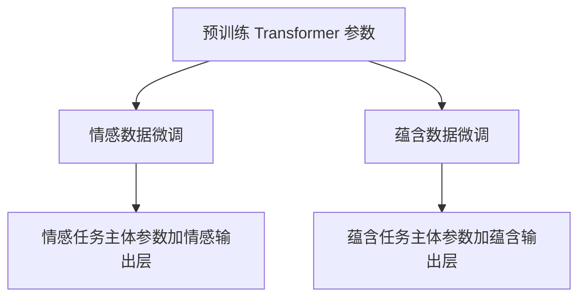

---
aliases:
  - 判别式训练得到的模型
  - 判别式微调
tags:
  - 知识点
  - 迁移学习
updated: 2026-10-10
---

# 生成式预训练与判别式微调的区别

**GPT1 先用文本预测任务学习参数，再用带标注的任务数据继续训练这些参数。**前者是生成式预训练，后者是判别式微调；同一个模型主体先后接受两种训练信号。

## 两个阶段分别学习什么

| 比较项 | 生成式预训练 | 判别式微调 |
| --- | --- | --- |
| 数据 | BooksCorpus 中连续的书籍文本 | 具体任务的标注样本 |
| 直接目标 | 根据前文预测真实的下一个词元 | 根据输入预测任务标签、分数或候选答案 |
| 答案来源 | 原始文本自身 | 任务数据提供的标注 |
| 示例 | 根据“我们去”预测原文中的“公园” | 判断两句话是否表达相同意思 |
| 作用 | 学习可迁移的参数和表示 | 将预训练参数适配到具体任务 |

例子只用于说明目标；真实预测单位是分词器产生的词元。两类数据的详细分工见 [[GPT1的数据集用途与训练阶段]]。

## 判别式训练是什么

判别式训练直接学习**输入与任务答案之间的关系**。例如，输入“男孩在踢足球”和“有人在运动”，模型预测它们的关系为“蕴含”；输入一段文章、一个问题和候选答案，模型判断哪个候选更可能正确。

分类或候选选择时，常写为给定输入 $x$ 的标签概率 $P(y\mid x)$。例如：

$$
P(\text{蕴含}\mid \text{前提},\text{假设}).
$$

但判别式任务不只包含分类：STS-B 要预测连续的语义相似度分数，属于回归任务。论文各类任务及示例统一见 [[GPT1的文本蕴含相似度与问答任务]]。

“判别式训练得到的模型”描述的是训练目标，**不说明模型是否经过预训练**。直接从随机参数训练任务模型，以及先预训练再进行任务微调，都可以使用判别式训练。

## 微调如何接上预训练

微调时，GPT1 增加任务输出层，并**继续更新模型主体的预训练参数**，不是只训练新增分类器。对于序列分类，任务输出层使用最后一个位置的顶层表示；不同任务的输入组织方式见任务笔记，模型内部计算见 [[GPT1模型架构]]。

微调还可以同时保留词元预测要求。这是 [[GPT1微调的辅助语言建模目标]]，它的公式、权重及实验效果由该笔记统一说明。

### 只增加输出层 不等于只训练输出层

GPT1 的做法是全模型微调：预训练参数作为起点，而非固定不动的特征提取器。参与任务计算的词元与位置嵌入、12 层 Transformer 中的注意力、前馈网络及层归一化参数，以及新增任务输出层，都处于可训练状态。

| 训练方式 | Transformer 主体 | 任务输出层 | 是否为本文做法 |
| --- | --- | --- | --- |
| 冻结主体，只训练任务头 | 不更新 | 更新 | 不是 |
| 全模型微调 | 从预训练参数继续更新 | 更新 | 是 |

对于分类，可以写成：

$$
h=f_\Theta(x),\qquad P(y\mid x)=\operatorname{softmax}(hW_y).
$$

任务损失先影响输出层，再通过链式求导传回 $f_\Theta$，因此更新的不仅是 $W_y$，还有主体参数 $\Theta$。可训练不等于每个参数在每个批次中都必然发生非零变化。

论文第 3.2 节说新增参数很少，指的是架构上仅增加任务输出层和特殊词元嵌入，**不是说只有新增参数参与训练**。第 2 节还将该方法与“把预训练表示作为辅助特征，再训练另一模型”的方案区分开来。

## 新增输出层的目的与任务切换

Transformer 末端输出的是 768 维表示 $h$，不是现成的类别。$W_y$ 将表示转换为具体任务需要的分数。它学习“怎样从表示中读出答案”，而主体微调使表示本身更适合这个任务。

以情感分类为例，忽略偏置，输出层的维度为：

$$
\underbrace{h}_{1\times768}\underbrace{W_y}_{768\times2}
=\underbrace{[s_{\text{正面}},s_{\text{负面}}]}_{1\times2}.
$$

两个分数再经 softmax 变为概率。三分类蕴含任务需要三个类别分数；相似度评分任务预测连续数值；选择题则给每个候选打分，再在候选间归一化。这里的维度例子说明输出层的作用，不是将所有任务实现都限定为同一种分类头。

| 任务 | 输出的含义 | 是否可直接复用另一个任务的输出权重 |
| --- | --- | --- |
| 情感二分类 | 正面、负面 | 不能因同为二分类就复用语法判断的权重 |
| 语法可接受性 | 可接受、不可接受 | 标签与情感任务不同，需任务适配 |
| 三分类蕴含 | 蕴含、矛盾、中立 | 类别数与含义都不同 |

**每个任务分别从同一套预训练参数开始微调，得到自己的主体参数与输出层。**可以示意为：

因此，使用本文训练出的不同任务模型时，通常加载各任务对应的整套权重，不只是给情感任务的主体换上蕴含输出层。即使输出层形状相同，标签含义不同也不能直接互换。共享主体、多任务训练是其他设计选择，不是本文默认的分别微调流程。

## 预训练时已经训练问答和相似度了吗

**没有显式训练这些下游任务。**GPT1 的第一阶段只使用语言建模目标，没有加入问答正确选项、相似度分数或蕴含标签。论文将前提与假设、问题与候选答案等拼接成序列，是第二阶段的任务适配方法。

预测文本可能学到对这些任务有用的语义和上下文规律，但“学到有用信息”不等于“提前接受了相应任务的监督训练”。预训练为何可能带来这种迁移，见 [[生成式预训练]]。

## 来源

- [[Improving Language Understanding by Generative Pre-Training_完整中文翻译#3 框架]]：两阶段方法、任务输出与输入变换。
- [[language_understanding_paper.pdf]]：原论文。
